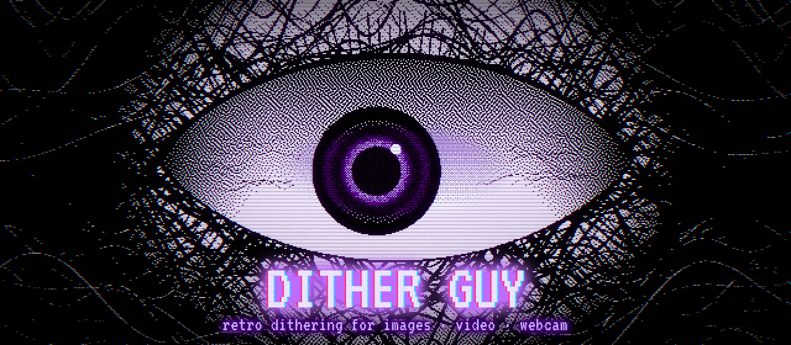
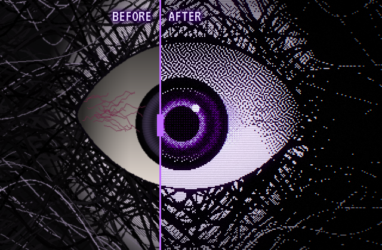
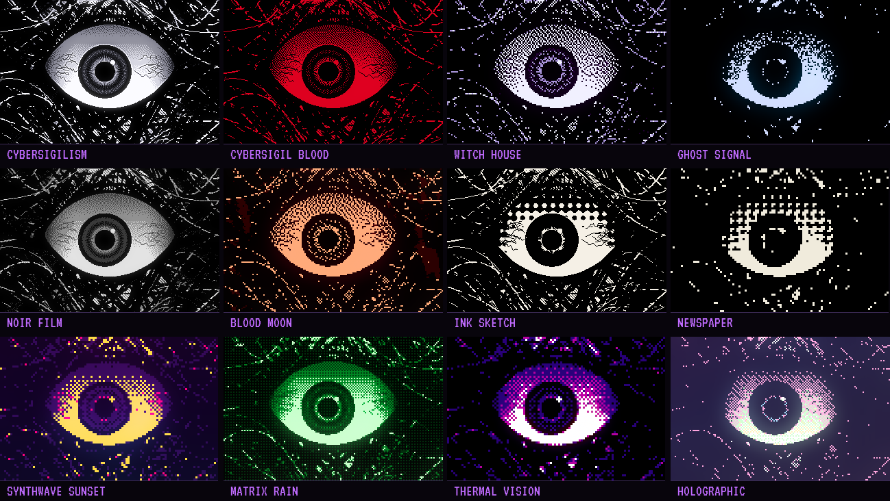
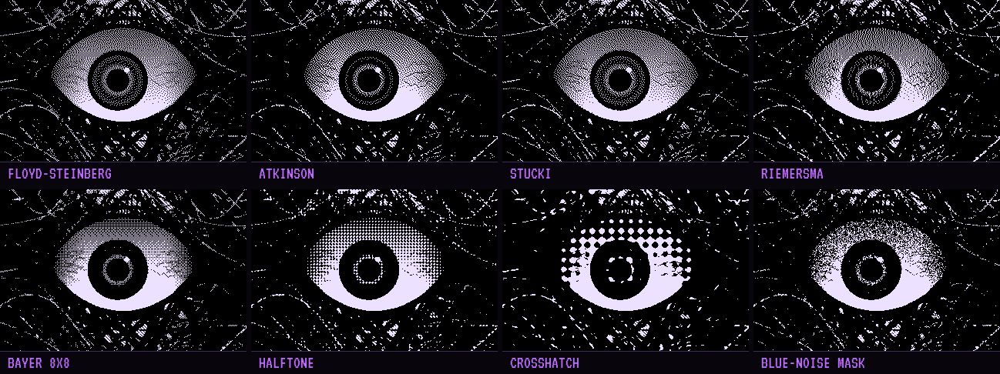
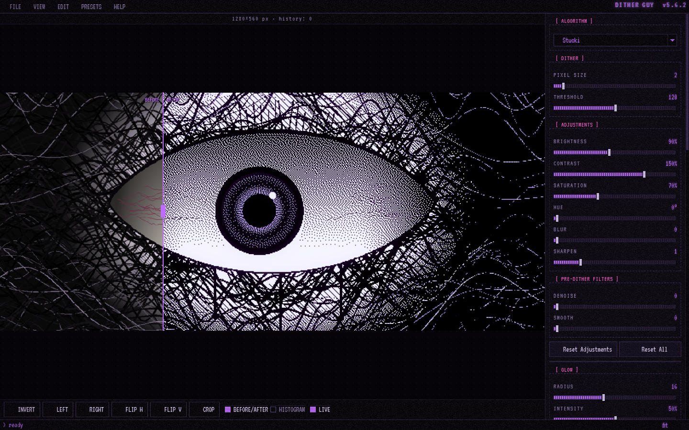

<div align="center">



<br>

[](https://github.com/natachaaaaa/dither-guy/actions)
[](https://github.com/natachaaaaa/dither-guy/releases/latest)
[](https://github.com/natachaaaaa/dither-guy/releases)
[](LICENSE)
[](https://python.org)

**Turn any image, video or webcam feed into crisp retro dithering —<br>ink, phosphor, halftone, glitch.**

### [⬇ Windows](https://github.com/natachaaaaa/dither-guy/releases/latest) &nbsp;·&nbsp; [⬇ macOS](https://github.com/natachaaaaa/dither-guy/releases/latest) &nbsp;·&nbsp; [⬇ Linux](https://github.com/natachaaaaa/dither-guy/releases/latest)

<sub>Originally created by <a href="https://github.com/manoelpiovesan"><b>Manoel Piovesan</b></a> · inspired by <a href="https://studioaaa.com/product/dither-boy/"><b>Dither Boy</b></a> by Studio AAA · <a href="#credits">full credits ↓</a></sub>

</div>


## ◉ Before / after



Load a picture, pick a look, and watch it rebuild itself out of dots, lines and noise in real time.

Drag the **before / after** line across the canvas (<kbd>Ctrl</kbd>+<kbd>K</kbd>) to compare with the original, pick colours straight from the image with the eyedropper, and undo any slider move with <kbd>Ctrl</kbd>+<kbd>Alt</kbd>+<kbd>Z</kbd>.

Every image on this page — the eye, the grids, the screenshot — was **rendered by Dither Guy itself** from one original procedural drawing ([`tools/make_readme_assets.py`](tools/make_readme_assets.py)).

<br clear="right">


## ◉ 54 looks, one click



Presets are grouped into **Cyber · Synth & Y2K · Dark · Elements · Print & Analog · Retro Hardware · Classic**. Open the **preset browser** (<kbd>Ctrl</kbd>+<kbd>P</kbd>) to see every one of them applied to *your* image, star your favourites, and find the ones you used recently.


## ◉ 24 dithering algorithms



| Ordered | Error diffusion | Stochastic |
|---|---|---|
| Bayer 2×2 · 4×4 · 8×8, Clustered-Dot, Halftone, Blue-Noise, Void-and-Cluster, Pattern, Crosshatch, **Custom Matrix** (design your own) | Floyd-Steinberg, Atkinson, Sierra, Sierra-Lite, Jarvis-Judice-Ninke, Stucki, Nakano, Burkes, Stevenson-Arce, Ostromoukhov, Variable-Error, Dot-Diffusion, Riemersma | Blue-Noise Mask |

Error diffusion runs pixel-exact through **Numba** (milliseconds per image), with optional **CUDA / OpenCL** acceleration for ordered dithering and palette mapping.


## ◉ The toolbox

<table>
<tr>
<td width="50%" valign="top">

**Colour**
- 38 palettes (Game Boy, C64, Pico-8, Teletext, Cybersigilism, Synthwave, Risograph…)
- Custom palettes, eyedropper, **extract a palette** from any image
- **Gradient glow** — 21 gradient templates, custom stops, 5 layouts

**Composition**
- **Layer B**: blend a second look through a mask (bright/dark areas, split, centre, or your own mask image)
- **CRT FX** baked into the export: scanlines, chromatic aberration, curvature, noise, vignette
- **Glitch FX**: RGB split, block shift, pixel sorting
- **ASCII mode** with six character sets

</td>
<td width="50%" valign="top">

**Video & live**
- Video preview with audio, MP4 and animated **GIF** export
- **Animate** any setting over the clip (linear, ping-pong, sine loop)
- **Live webcam** dithering, with frame snapshots
- Batch-process a whole folder

**Export**
- PNG, **indexed PNG**, lossless WEBP, GIF, JPEG
- **SVG** — every pixel becomes a vector shape
- **TXT** — the ASCII art itself
- Sharp integer upscaling ×2 to ×8

</td>
</tr>
</table>


## ◉ The app



A neon-violet terminal interface in the **VT323** pixel font, with phosphor glows and CRT scanlines on the chrome — never on your image, so what you see is what you export. Switch the effects off in **View → CRT Effects**.


## ◉ Install

Download the latest build from **[Releases](https://github.com/natachaaaaa/dither-guy/releases/latest)**.

| Platform | File | First launch |
|---|---|---|
| **Windows** | `DitherGuy-Windows.exe` (`-CUDA` for NVIDIA GPUs) | SmartScreen may say *"Windows protected your PC"* → **More info → Run anyway** |
| **macOS** (Apple Silicon) | `DitherGuy-macOS.dmg` — drag the app into **Applications** | The app is not notarised: **System Settings → Privacy & Security → Open Anyway** (once) |
| **Linux** | `DitherGuy-Linux` (`-CUDA` for NVIDIA GPUs) | `chmod +x DitherGuy-Linux` then run it |

Your presets live in `~/.dither_guy/presets` — drop any `.json` preset there.

<details>
<summary><b>Keyboard shortcuts</b></summary>

| Action | Shortcut |
|---|---|
| Open · Save / Export · Batch | <kbd>Ctrl</kbd>+<kbd>O</kbd> · <kbd>Ctrl</kbd>+<kbd>S</kbd> · <kbd>Ctrl</kbd>+<kbd>B</kbd> |
| Preset browser | <kbd>Ctrl</kbd>+<kbd>P</kbd> |
| Before / after | <kbd>Ctrl</kbd>+<kbd>K</kbd> |
| Undo image edit | <kbd>Ctrl</kbd>+<kbd>Z</kbd> |
| Undo · Redo settings | <kbd>Ctrl</kbd>+<kbd>Alt</kbd>+<kbd>Z</kbd> · <kbd>Ctrl</kbd>+<kbd>Y</kbd> |
| Randomize · Reset | <kbd>Ctrl</kbd>+<kbd>R</kbd> · <kbd>Ctrl</kbd>+<kbd>D</kbd> |
| Zoom in · out · fit · 100 % | <kbd>Ctrl</kbd>+<kbd>=</kbd> · <kbd>Ctrl</kbd>+<kbd>-</kbd> · <kbd>Ctrl</kbd>+<kbd>0</kbd> · <kbd>Ctrl</kbd>+<kbd>1</kbd> |

</details>


## ◉ Development

```bash
python3 -m venv venv
source venv/bin/activate          # Windows: venv\Scripts\activate
pip install -r requirements.txt
python3 main.py
```

```bash
pip install pytest
python -m pytest tests -q          # 176 tests, incl. a reference render of every preset
```

| Task | Command |
|---|---|
| Refresh preset reference images after an intended visual change | `python tests/update_snapshots.py` |
| Regenerate the artwork on this page | `python tools/make_readme_assets.py` |
| Check a built executable end-to-end | `DitherGuy --selftest report.txt` |

Every push runs the tests first; the Windows, macOS and Linux builds only start if they pass, and each built app is launched with `--selftest` before it can be released.


## ◉ Credits

<table>
<tr><td>

**Dither Guy was created by [Manoel Piovesan](https://github.com/manoelpiovesan)** — the original author and maintainer of the project at **[manoelpiovesan/dither-guy](https://github.com/manoelpiovesan/dither-guy)**. This repository is a fork built on top of his work; all the credit for the idea and the foundations is his.

</td></tr>
</table>

- **Original author** — [@manoelpiovesan](https://github.com/manoelpiovesan) · support him on [Ko-fi](https://ko-fi.com/L3L61SRB88)
- **Maintainer** — [@shahil-sk](https://github.com/shahil-sk)
- **Contributor** — [@momed081](https://github.com/momed081)
- **Supporter** — Timo Frank
- **Inspiration** — [Dither Boy](https://studioaaa.com/product/dither-boy/) by **Studio AAA**, the dithering app that started it all. Dither Guy is an independent open-source project, not affiliated with Studio AAA.
- **Font** — [VT323](https://fonts.google.com/specimen/VT323) by Peter Hull, under the [SIL Open Font License](fonts/OFL.txt)
- **This fork** — [@natachaaaaa](https://github.com/natachaaaaa): retro interface, gradient glow, preset library & browser, layers, CRT/glitch FX, ASCII, new exports, webcam, macOS DMG and test suite

<br>

<div align="center">

**If you like it, star the repo ★ and [support the original author](https://ko-fi.com/L3L61SRB88).**

<sub>Released under the <a href="LICENSE">GNU General Public License v3.0</a>, like the original project.</sub>


</div>
